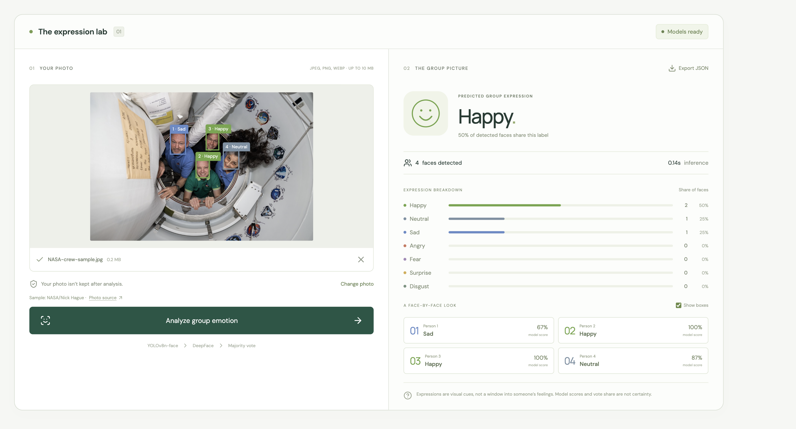
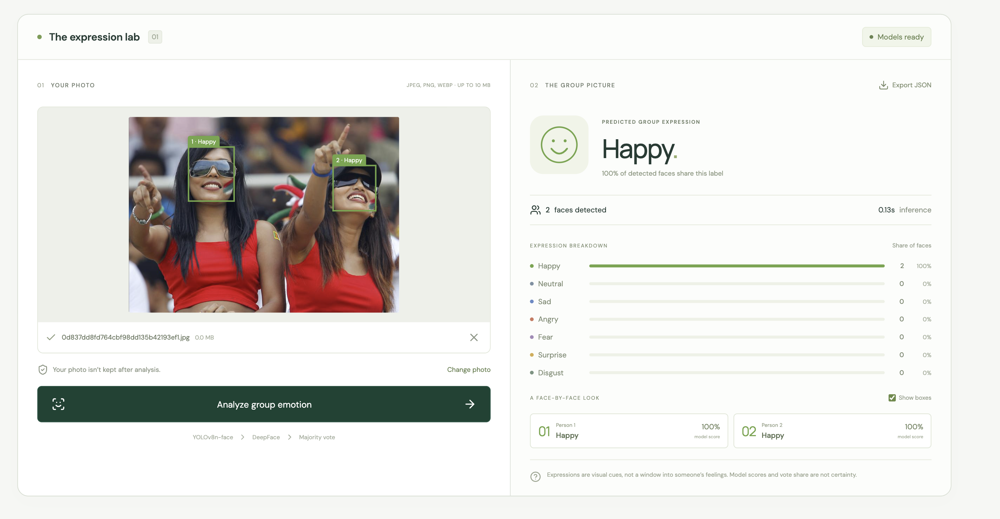
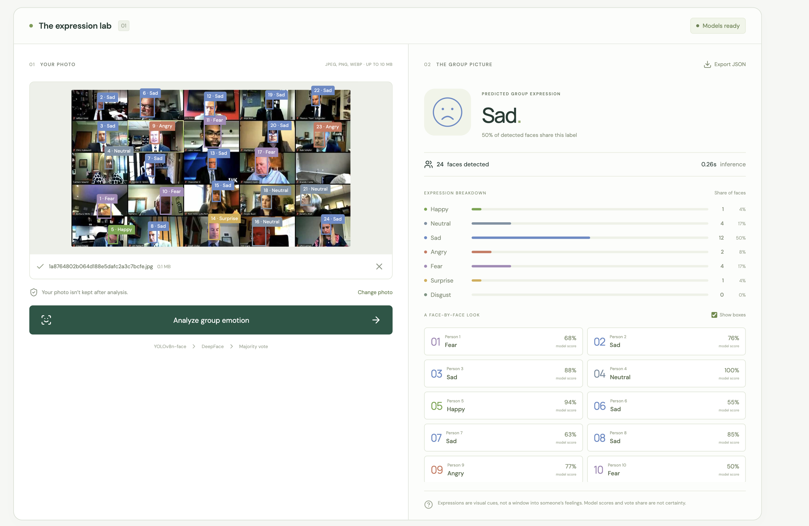
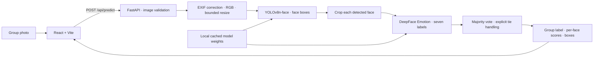

# GroupEmotionDetection

**Upload a group photo. Detect the faces. Explore the expressions behind the group label.**

GroupEmotionDetection turns my facial expression research into an interactive full-stack demo. A React interface sends a photo to a FastAPI service, which runs YOLOv8n-face detection and DeepFace emotion classification, then summarizes the group with majority voting.

The app connects model comparison, annotation, and evaluation to an inspectable user experience: color-coded face boxes, individual model scores, a seven-class breakdown, and a downloadable JSON result.

## Demo recording

[Watch the screen recording (MP4)](docs/media/groupemotion-demo.mp4) — a walkthrough of the running app, captured on October 18, 2026.

## Screenshots

### NASA crew sample

Four detected faces: two predicted happy, one neutral, and one sad. The group prediction is **Happy**, with a 50% vote share.



### Two-person photo

Both detected faces are predicted **Happy**, giving the group a 100% vote share for that label.



### Larger group

The app detects 24 faces in a video-call image. Twelve are predicted sad, producing a **Sad** group label with a 50% vote share; the panel also shows the other expression labels.



These screenshots show model predictions about visible expressions. Vote share and individual model scores do not establish people's actual feelings.

## The demo

- Upload or drag in a JPEG, PNG, or WebP photo, up to 10 MB.
- Or load the credited NASA crew sample and run it through the same models.
- Run the actual pretrained models on CPU.
- See the predicted group expression and the share of faces voting for it.
- Select a person in the photo or results list to inspect their seven class scores.
- Toggle bounding boxes and export the complete prediction as JSON.
- Get explicit states for model startup, no faces, invalid files, and inference errors.

Photos are not retained after the request; multipart uploads may use temporary files managed by the server framework. Model weights are cached locally and excluded from Git. The application does not require a paid API, an API key, the original training dataset, or a Google Drive connection at runtime.

## Run with Docker

Prerequisites: Docker Desktop or Docker Engine with Compose. The Python ML image is substantially larger than a typical web app; allow time for the first build and model initialization.

```bash
git clone https://github.com/tmbharathiraja/GroupEmotionDetection.git
cd GroupEmotionDetection
docker compose up --build
```

Open **http://localhost:3001**. The frontend starts after the backend reports that its models are ready.

| Service | URL |
| --- | --- |
| Web app | http://localhost:3001 |
| Model readiness | http://localhost:8001/api/health |
| API documentation | http://localhost:8001/docs |

Ports 3001 and 8001 avoid StyleLens's default ports. To change them, copy `.env.example` to `.env` and edit `FRONTEND_PORT` / `BACKEND_PORT`. The frontend proxies API calls, so the browser uses one origin without an embedded backend hostname.

The first container start downloads about 12 MB of model weights into a named volume. Later restarts reuse that cache. The main framework dependencies are installed during the image build. The backend runs CPU inference with one worker.

```bash
docker compose logs -f backend
docker compose down
```

## Run locally for development

Use **Python 3.12**, **Node.js 22.12+**, and [uv](https://docs.astral.sh/uv/), or equivalent Python environment tooling.

```bash
make setup
make models
```

In two terminals:

```bash
make backend
```

```bash
make frontend
```

Open **http://localhost:3001**. Vite proxies `/api` to `127.0.0.1:8001`. Use `API_PROXY_TARGET` if you run the development API elsewhere. The status indicator changes to “Models ready” once initialization completes.

Without uv, create a Python 3.12 virtual environment and install `backend/requirements-dev.txt` with pip. Without Make, run the corresponding commands in the [Makefile](Makefile).

## Architecture



| Layer | Implementation |
| --- | --- |
| Interface | React 19, Vite, Lucide icons, responsive CSS |
| API | FastAPI, Uvicorn, multipart uploads, Pydantic response schema |
| Face detector | Ultralytics YOLOv8n-face; confidence threshold 0.3; detector input 640 |
| Emotion classifier | DeepFace 0.0.93 Emotion; cropped faces, alignment off, second detector skipped |
| Aggregation | Majority vote; score-based tie break; stable label order for exact ties |
| Image processing | Pillow, NumPy, EXIF orientation correction, 1,920-pixel longest edge |
| Runtime | CPU PyTorch + TensorFlow; model loading at startup; serialized inference |
| Packaging | Docker Compose, Nginx API proxy, persistent model cache |
| Verification | Pytest API/aggregation tests, Vitest interaction tests, GitHub Actions |

The browser uses percentages to align face overlays with the processed image's aspect ratio. Bounding boxes are `[x1, y1, x2, y2]` in processed-image pixels. Only emotion analysis is requested from DeepFace.

## Research and results

The project started with 3,083 scraped group images, 144 exact duplicates removed, and a manually reviewed Label Studio subset. I compared multiple detection backends and chose YOLOv8n-face + DeepFace for the serving pipeline.

The original report recorded **59.7% face classification accuracy** and **53.7% group classification accuracy** on its matched evaluation subset. These are historical results, not a fresh benchmark of this app. Unmatched faces were excluded from the original evaluation, including the group votes, so those figures do not describe end-to-end detection performance. See [research notes](docs/research.md) for weighted precision/recall/F1, evaluation methodology, model comparison, and serving differences.

The cleaned original [research notebook](research/EmotionRecognition.ipynb) is included. The scraped dataset, private annotation files, environment folders, and model binaries are excluded.

For a reproducible example, see the [NASA sample inference visualization](docs/example-output.png) and its [complete API response](docs/sample-prediction.json).

## API

```bash
curl -F 'file=@/path/to/group.jpg' http://localhost:8001/api/predict
```

The response includes:

```json
{
  "image": { "width": 1200, "height": 800 },
  "group": {
    "emotion": "happy",
    "agreement": 0.75,
    "counts": { "happy": 3, "neutral": 1, "sad": 0, "angry": 0, "fear": 0, "surprise": 0, "disgust": 0 },
    "tied": false,
    "method": "majority_vote"
  },
  "faces": [
    {
      "id": 1,
      "box": [180, 120, 260, 230],
      "emotion": "happy",
      "score": 0.8,
      "detection_score": 0.94,
      "scores": { "happy": 0.8, "neutral": 0.1, "sad": 0.04, "angry": 0.01, "fear": 0.02, "surprise": 0.02, "disgust": 0.01 }
    }
  ],
  "elapsed_ms": 820.5,
  "warnings": [],
  "model": "YOLOv8n-face + DeepFace Emotion"
}
```

This illustrative response omits three faces from the `faces` list for brevity. `/docs` provides the full typed schema, and [sample-prediction.json](docs/sample-prediction.json) contains a complete real response. Scores and agreement are fractions in `[0, 1]`. **Agreement means vote share, not prediction confidence.** Individual model scores are also not calibrated certainty. A tie is marked and resolved using summed class scores across all analyzed faces. No detections yields `emotion: "no_faces"`, zero agreement, and an empty face list.

The service accepts photos up to 10 MB and 25 megapixels, requires dimensions of at least 32 pixels, and analyzes at most 64 faces. A larger detected group is explicitly flagged. It rejects unsupported or corrupt images, returns `503` when models are unavailable, and `429` when inference is already busy.

## Checks

```bash
make test
make build
```

Tests cover aggregation and ties, no-face behavior, invalid uploads, file size and image size limits, EXIF rotation, unavailable/busy models, API errors, and browser upload/result interactions. Unit tests use injected model responses and do not download weights. CI runs those tests and builds the frontend. Real pretrained inference is a separate integration check.

With the API running, exercise the actual models on the included sample:

```bash
.venv/bin/python scripts/smoke_test.py
```

Use `--base-url http://localhost:3001` to test through the frontend proxy, or `--image /path/to/photo.jpg` for another image. This check validates real detections, score normalization, and bounding-box coordinates. The sample response above was captured on the local CPU runtime; model outputs can vary across environments.

## Repository guide

```text
backend/app/          API, model service, image decoding, response schemas
backend/tests/        API and aggregation tests without model downloads
react-frontend/       React app, interaction tests, production Nginx image
scripts/              Model downloader, real-inference check, container startup
research/             Cleaned original notebook
docs/                 Research context, attribution, and demo screenshots
.github/workflows/    Backend/frontend checks
docker-compose.yml   Two-service local deployment
```

## GitHub showcase

Source repository: [tmbharathiraja/GroupEmotionDetection](https://github.com/tmbharathiraja/GroupEmotionDetection).

This is a standalone project, with no dependency on the adjacent StyleLens checkout. The README includes the supplied demo recording and screenshots. Model weights, local environments, original uploaded photos, and datasets stay outside version control. See the [third-party model and asset sources](docs/THIRD_PARTY.md) for attribution and upstream license information.

Docker Compose can also run on a Linux host. A public deployment needs a host capable of running the Python ML backend; GitHub Pages alone can serve only the frontend. Both default port bindings are local to the host. For remote access, configure the frontend binding and an HTTPS reverse proxy while keeping the API behind the frontend proxy.

## Interpreting expressions

This is an exploratory computer vision demo. Visible facial expressions do not establish people's internal feelings. Lighting, pose, face size, occlusion, and training-set bias affect outputs; majority voting also hides disagreement within the group. See [documented limitations](docs/research.md) before interpreting the model's predictions.
